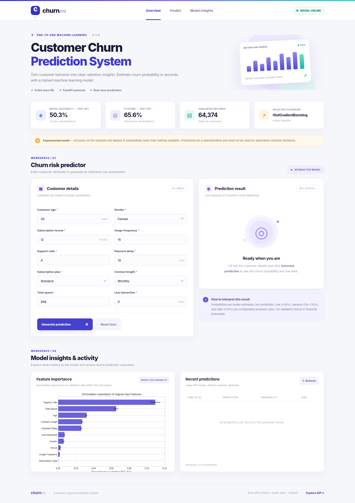
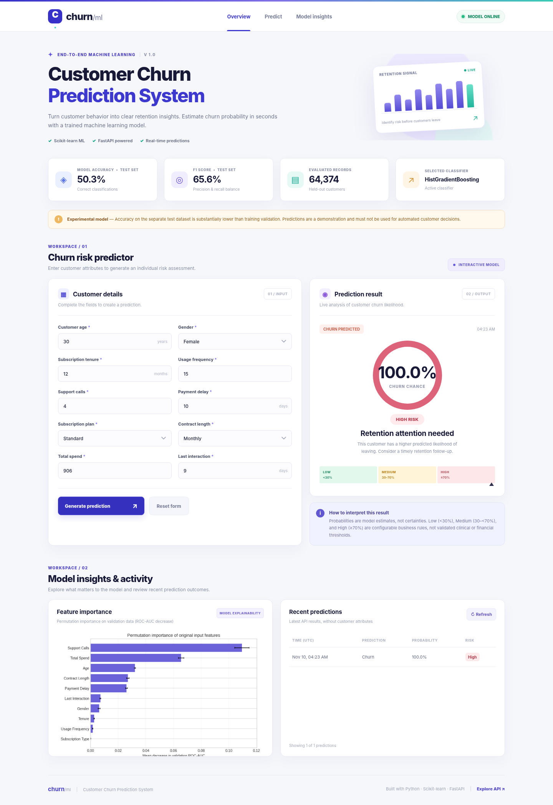
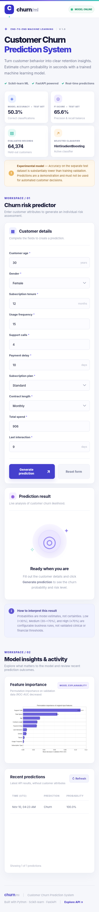

# Customer Churn Prediction System

**Beginner–Intermediate portfolio project | Python 3.11+ | Scikit-learn | FastAPI | HTML/CSS/JavaScript | SQLite | Docker**

A complete working ML application that loads a public churn dataset, performs EDA, trains and evaluates classification models, serves predictions through a FastAPI REST API, and offers a responsive web interface with a probability estimate, risk category, and recent prediction history.

> **Evaluation warning.** The selected classifier scores **99.97% on an internal validation split but only 50.33% accuracy on the separate supplied test file** (majority-class baseline: 52.63%). The files likely reflect different data distributions or label relationships. This is **an educational prototype, not a reliable business decision service**. Read [the evaluation report](reports/model_evaluation.md) before using any predictions. Model probabilities are uncalibrated for the supplied test population.

## Demo screenshots

| Main dashboard | Churn result | Mobile |
|---|---|---|
|  |  |  |

## 1. Project structure

```text
customer_churn_prediction_system/
├── app/
│   ├── __init__.py
│   ├── main.py                 # FastAPI endpoints, logging and error handling
│   ├── schemas.py              # Pydantic input / output validation
│   ├── database.py             # SQLite prediction history
│   └── static/
│       ├── index.html          # Responsive frontend
│       ├── style.css
│       ├── app.js
│       └── favicon.svg
├── data/
│   └── raw/
│       ├── README.md           # Dataset attribution and naming
│       ├── train.csv           # Training data supplied by project author
│       └── test.csv            # Separate test data supplied by project author
├── ml/
│   ├── common.py               # Column mappings, dataset loading and cleaning
│   ├── eda.py                  # Exploratory data analysis and figures
│   ├── train.py                # Scikit-learn Pipeline, validation and testing
│   └── report.py               # Generate model evaluation report
├── models/
│   ├── churn_pipeline.joblib   # Serialized preprocessing AND trained model
│   └── model_metadata.json     # Hyperparameters, performance, thresholds
├── reports/
│   ├── model_evaluation.md
│   ├── metrics.json
│   ├── eda_summary.json
│   ├── model_comparison.csv
│   ├── feature_importance.csv
│   ├── classification_report.txt
│   └── figures/               # EDA + confusion matrix + ROC + calibration + importance
├── screenshots/                # Desktop, prediction and mobile images
├── scripts/
│   └── capture_screenshots.py  # Screenshot capture (optional Playwright)
├── tests/
│   ├── test_api.py
│   └── test_data.py
├── .github/workflows/ci.yml    # Continuous integration tests
├── .env.example
├── .gitignore
├── Dockerfile
├── compose.yaml
└── requirements.txt
```

## 2. Install and run locally

### Requirements

- Python **3.11 or later**, preferably Python **3.13** (matching the bundled model environment)
- pip, a terminal, and Git
- Docker + Docker Compose plugin **only if** you use the Docker method

On Windows use `py -3.13` rather than `python3` if necessary. On macOS/Linux:

```bash
# Extract the ZIP and change into the extracted project directory.
cd customer_churn_prediction_system
python -m venv .venv
source .venv/bin/activate
python -m pip install --upgrade pip
python -m pip install -r requirements.txt
python -m uvicorn app.main:app --reload --host 127.0.0.1 --port 8000
```

For Windows PowerShell, activate with `.venv\Scripts\Activate.ps1`. If PowerShell script policies block activation, use `.venv\Scripts\python.exe` for subsequent commands.

Open these pages in your browser:

- **Frontend:** http://127.0.0.1:8000/
- **Interactive Swagger API docs:** http://127.0.0.1:8000/docs
- **Health check:** http://127.0.0.1:8000/health
- **Model information:** http://127.0.0.1:8000/model/info
- **Prediction history:** http://127.0.0.1:8000/predictions

A trained model, metadata, and EDA/assessment outputs are **already included in the project ZIP**. Training is not required before the first API prediction.

## 3. Reproduce the data analysis and model training

From the project root with the environment activated:

```bash
python -m ml.eda
python -m ml.train
python -m ml.report
python -m pytest -q
```

What each command does:

1. `ml.eda` inspects training/test records, cleans one entirely blank row in `train.csv`, and saves charts and a dataset summary in `reports/`.
2. `ml.train` performs an 80/20 stratified validation split on the **provided training file only**, compares **Logistic Regression** and **Histogram Gradient Boosting**, selects by validation ROC-AUC, refits on all training records, evaluates once on the **separately supplied test CSV**, then saves the Scikit-learn Pipeline, metrics, confusion matrix, ROC curve, calibration diagnostic, and permutation feature-importance chart.
3. `ml.report` regenerates the readable test results / limitations report at `reports/model_evaluation.md`.
4. `pytest` tests validation, live model inference, history persistence, pagination, privacy, error handling, preprocessing, and the browser page route. **17 tests passed locally.**

The preprocessing is **inside the saved Pipeline**, not manually duplicated in the API. It applies median imputation and standard scaling to numeric attributes; and most-frequent imputation with one-hot encoding to categorical ones. This design avoids mismatches between model training and API requests.

### Dataset source

Kaggle: https://www.kaggle.com/datasets/muhammadshahidazeem/customer-churn-dataset

The user-provided archive includes `customer_churn_dataset-training-master.csv` and `customer_churn_dataset-testing-master.csv`; these are renamed `train.csv` and `test.csv` here. An additional publicly viewable training-data mirror exists at https://huggingface.co/datasets/MatanKriel/Matan-Kriel-Customer-Churn-dataset . The Kaggle terms and origin of the data should be checked before redistributing raw records in a public repository; this README does not grant a license.

There are **440,833 original training rows** (one unlabeled, completely blank row removed) and **64,374 test rows**. The training label distribution is ~56.7% churn, compared with ~47.4% in test. `CustomerID` is excluded as an identifier. This dataset does **not** include `monthly_charges`, `total_charges`, or `internet_service`, unlike some other churn datasets.

## 4. REST API contract

### `GET /health`

Returns `200` and `{"status":"ok","model_loaded":true}` while the model is ready. Returns `503` when unavailable.

### `POST /predict`

All ten values correspond to the real columns in this dataset:

```bash
curl -X POST http://127.0.0.1:8000/predict \
  -H 'Content-Type: application/json' \
  -d '{
    "age": 30,
    "gender": "Female",
    "tenure": 12,
    "usage_frequency": 15,
    "support_calls": 4,
    "payment_delay": 10,
    "subscription_type": "Standard",
    "contract_length": "Monthly",
    "total_spend": 906,
    "last_interaction": 9
  }'
```

Example response **shape** (numbers are illustrative and depend on the saved model):

```json
{
  "prediction": "Churn",
  "probability": 0.87,
  "risk_level": "High"
}
```

- `prediction`: `Churn` when estimated class-1 probability >= 0.50, otherwise `No Churn`.
- `probability`: Scikit-learn estimate of **P(churn = 1)** from the trained pipeline. Not guaranteed calibrated for the different supplied test distribution.
- `risk_level`: `Low` if probability < 0.30; `Medium` for 0.30–<0.70; `High` at >= 0.70. These boundaries are illustrative.

Pydantic validates required fields, types, plausible ranges, and categorical values. Extra/unknown attributes are not accepted.

Example invalid-input response (HTTP 422):

```json
{
  "error": {
    "code": "VALIDATION_ERROR",
    "message": "Invalid input.",
    "details": [{"field": "body.age", "message": "Input should be greater than or equal to 18"}]
  }
}
```

Internal errors return a generic `500` JSON response with `error.code = "INTERNAL_ERROR"`; stack traces and customer fields are **not** returned in the response.

### `GET /model/info`

Returns classifier name, trained timestamp, input features, risk boundaries, validation comparison, and held-out test metrics.

### `GET /predictions?limit=10&offset=0`

Returns recent prediction history from **SQLite**, with pagination (`limit` 1–100). Only prediction outcome, probability, risk category, timestamp, and internal row ID are saved. **Input customer attributes are not persisted.**

## 5. Docker deployment

From the extracted project root:

```bash
docker compose up --build -d
# Visit http://localhost:8000/ and http://localhost:8000/docs
docker compose logs -f
# To stop:
docker compose down
```

The Dockerfile uses **Python 3.13** (which meets 3.11+) and pins Scikit-learn to the version used for the bundled model; the API runs as a **non-root user**. A named Docker volume persists prediction history. It copies the pretrained model so startup does not need expensive model training. The raw training CSV files are excluded from the Docker build to reduce image size.

**Verification note:** Docker files are provided but a Docker daemon/CLI was not available in the build environment; the Docker image itself has not been built here. Local FastAPI endpoints and frontend behavior **were** exercised.

## 6. GitHub submission

The ZIP provides the complete GitHub-ready project, including source code, model, evaluation, tests, screenshots, and `.github/workflows/ci.yml`. Upload these files to your own repository. After reviewing the dataset redistribution terms, run:

```bash
git init
git add .
git commit -m "Build end-to-end customer churn ML application"
git branch -M main
git remote add origin https://github.com/YOUR_USERNAME/customer-churn-prediction-system.git
git push -u origin main
```

Create the empty repository on GitHub first, then replace `YOUR_USERNAME`. GitHub publishing requires your own authenticated account; the delivered ZIP is not itself a hosted repository. GitHub Actions will automatically execute the tests for subsequent pushes.

## 7. Screenshots and demo proof

The `screenshots` directory contains:

- `dashboard_overview.png` — dashboard, EDA insights, customer form and original state.
- `prediction_result.png` — actual API prediction result, risk classification and a persisted SQLite history entry.
- `mobile_view.png` — responsive mobile layout.

Screenshots were generated in a Chromium browser, using a Python-to-local-API bridge for restricted browser navigation in the execution environment; the prediction and history values come from the **real running FastAPI server**, not a hardcoded JS response. To recreate them in a similar restricted environment, install Playwright and ensure Chromium is available, run the server on port 8795, then run `python scripts/capture_screenshots.py`.

## 8. Limitations and responsible use

- Model performance deteriorates strongly across the provided train/test files; do **not** treat the returned probability as a verified retention-risk probability.
- Data provenance, label-generation methodology, representativeness, and redistribution rights have not been independently established.
- The provided test file was kept untouched during model selection; a new representative holdout would be needed before operational use.
- SQLite history has no user authentication or retention policy. Add authentication, access control, monitoring, rate limits, and a privacy policy before public hosting.
- Load only **trusted local** Joblib models because serialized Python models may execute code when loaded.
- `test.csv` and `train.csv` use the same schema, but overlapping customer ID values across files should not be interpreted as proof that they refer to the same real people. The ID is excluded in any case.

**Project objective:** demonstrate a correct, complete ML development and serving workflow with honest evaluation, not claim production-grade churn accuracy.
