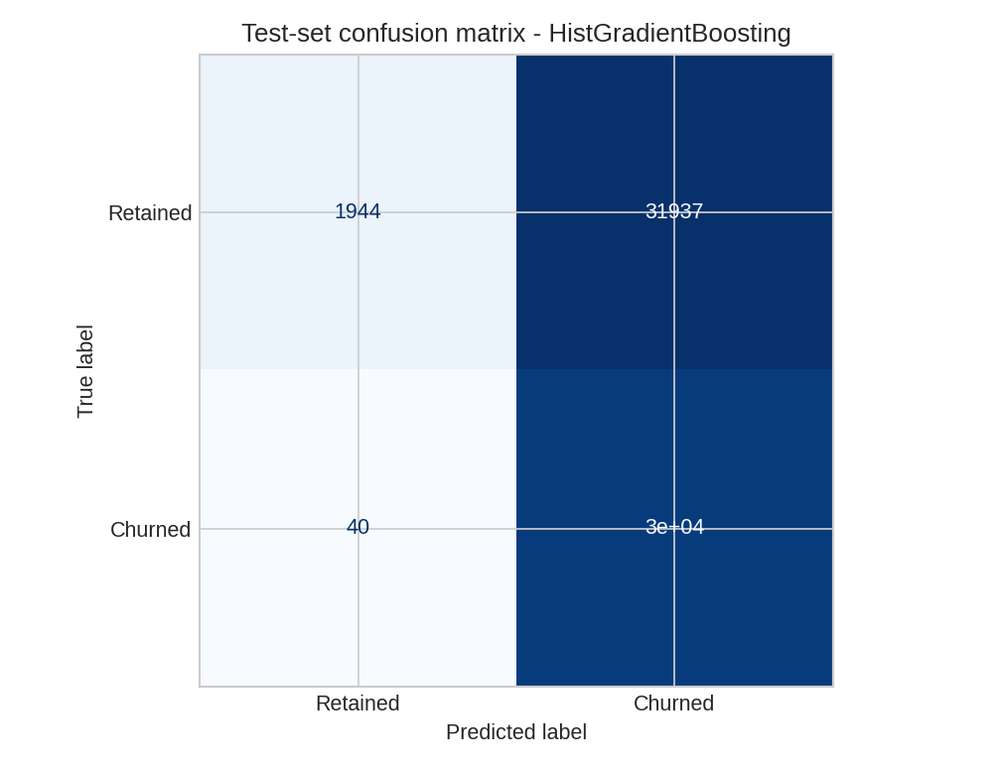
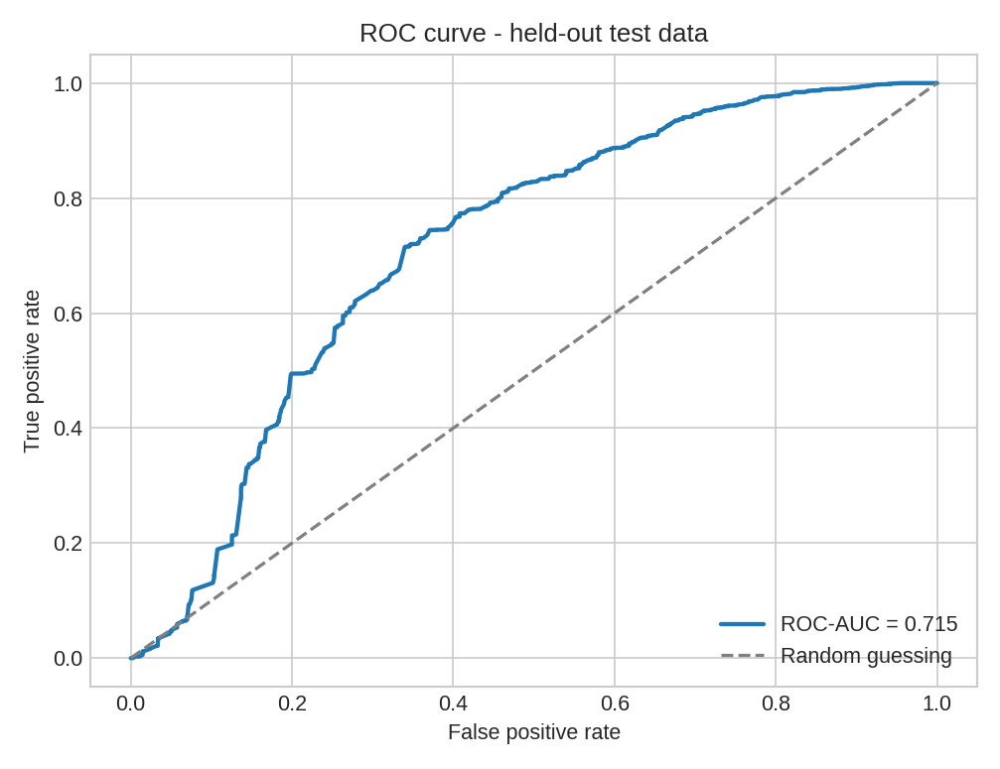
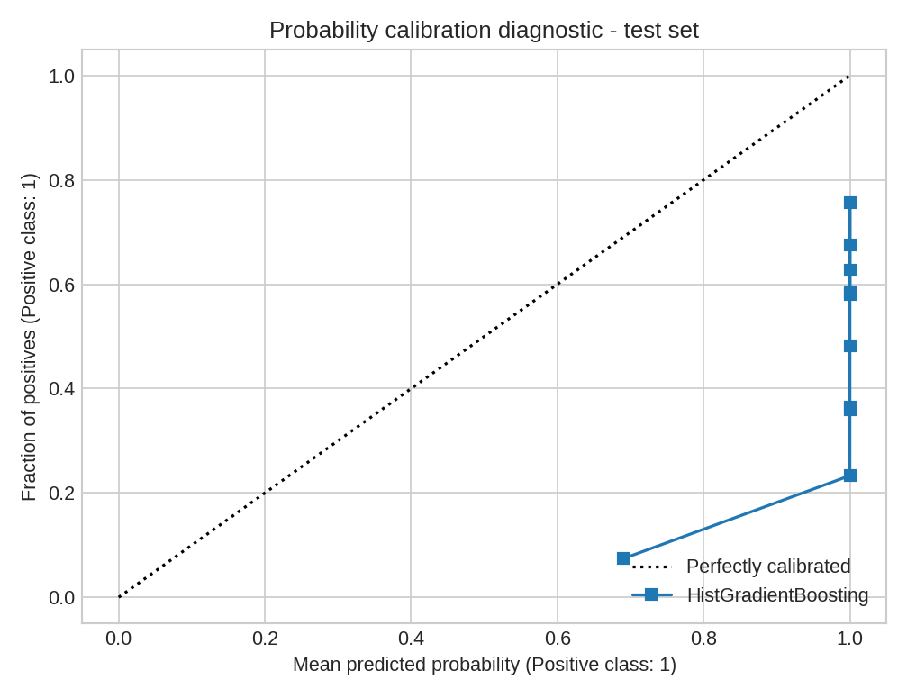
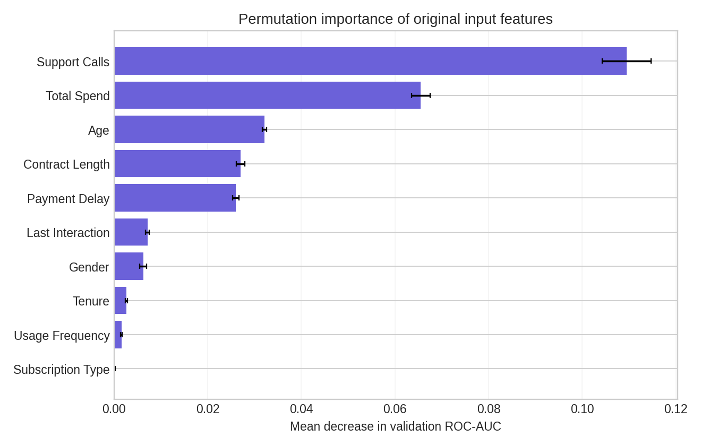

# Customer Churn Prediction System — Model Evaluation Report

Generated: 2026-11-10 (UTC)

## 1. Dataset and task

Predict **Churn** (0 = retained, 1 = churned) from 10 customer demographic, usage, and subscription attributes. User-provided CSVs originate from a publicly shared Customer Churn Dataset (see README for Kaggle link). CustomerID is excluded. Missing target records are dropped; one blank training row was removed. Missing feature values, if present, are imputed using statistics fitted on training folds only.

- Clean training records: **440,832**. Supplied test records: **64,374**.
- Training churn prevalence: **56.71%**. Test churn prevalence: **47.37%**.
- The supplied test set was **not used in model selection or parameter tuning**.

## 2. Preprocessing and experimental design

Numerical features: median imputation followed by standard scaling. Categorical features: most-frequent imputation followed by one-hot encoding (`handle_unknown='ignore'`). These transforms and the classifier are stored in the same Scikit-learn `Pipeline`. A stratified 80/20 split of the **provided training CSV** was used to compare models. Validation ROC-AUC, with F1 as a tie-breaker, selected the classifier. The winner was retrained on the full supplied training file, then evaluated once on the separate provided test file using a fixed 0.50 decision threshold. Random seed: 42.

## 3. Validation model comparison

| Candidate | Validation ROC-AUC | Validation F1 | Validation accuracy |
|---|---:|---:|---:|
| Logistic Regression | 0.9590 | 0.9040 | 89.34% |
| HistGradientBoosting | 1.0000 | 0.9997 | 99.97% |

Selected: **HistGradientBoosting** by validation ROC-AUC.

## 4. Held-out test performance (selected model)

| Metric | Test result |
|---|---:|
| Accuracy | **50.33%** |
| Precision (churn class) | **48.81%** |
| Recall (churn class) | **99.87%** |
| F1-score (churn class) | **65.57%** |
| ROC-AUC | **0.7155** |
| Brier score (lower better) | **0.4963** |
| Always-predict-majority baseline accuracy | **52.63%** |

Confusion matrix (actual rows × predicted columns):

| Actual / Predicted | Retained (0) | Churned (1) |
|---|---:|---:|
| Retained (0) | 1,944 | 31,937 |
| Churned (1) | 40 | 30,453 |

## 5. Distribution shift warning

**Critical:** The selected model has approximately **99.97%** validation accuracy but only **50.33%** on the supplied separate test data. Its test accuracy is below the simple majority-class baseline of **52.63%**. This large difference indicates that validation results do not carry over to the provided test distribution. The model labels nearly all supplied test records as churned. This is not acceptable evidence for live retention decisions.

The data themselves have different distributions:

| Input feature | Training mean | Test mean |
|---|---:|---:|
| Age | 39.37 | 41.97 |
| Tenure | 31.26 | 31.99 |
| Usage Frequency | 15.81 | 15.08 |
| Support Calls | 3.60 | 5.40 |
| Payment Delay | 12.97 | 17.13 |
| Total Spend | 631.62 | 541.02 |
| Last Interaction | 14.48 | 15.50 |

Differences in feature distributions, churn prevalence, and/or label-generating relationships could contribute. The original generating process and real-world representativeness have not been verified; no specific root cause can be proven from these CSVs alone.

## 6. Feature importance

Permutation importance was computed on a **2,500-record sample of the validation partition**, using 3 repeats and the decrease in ROC-AUC. Results describe model dependence on input features, **not causality**. The validation-split context matters because external generalization is poor.

| Feature | Validation ROC-AUC decrease |
|---|---:|
| Support Calls | 0.1095 |
| Total Spend | 0.0655 |
| Age | 0.0321 |
| Contract Length | 0.0270 |
| Payment Delay | 0.0260 |

## 7. Risk categories and limits

The API returns `P(Churn=1)` from `predict_proba` and a class using the **0.50** threshold. Risk level is a separate rule: **Low <0.30; Medium 0.30 to <0.70; High >=0.70**. These boundaries are illustrative configuration choices, not business-optimized cutoffs. Because external test calibration is poor, displaying a very high probability **does not guarantee churn**.

## 8. Recommended next steps

Before any practical retention decision, investigate the provenance and time period of both files; check for duplicate entities and label inconsistencies; collect a representative deployment sample; use a time- or group-aware holdout if relevant; evaluate more stable training data and external validation; calibrate and monitor probabilities; define thresholds using a real intervention-cost framework; and restrict access to prediction history.

**Intended use:** academic demonstration of an end-to-end FastAPI + Scikit-learn workflow, not a production-ready decision engine.
